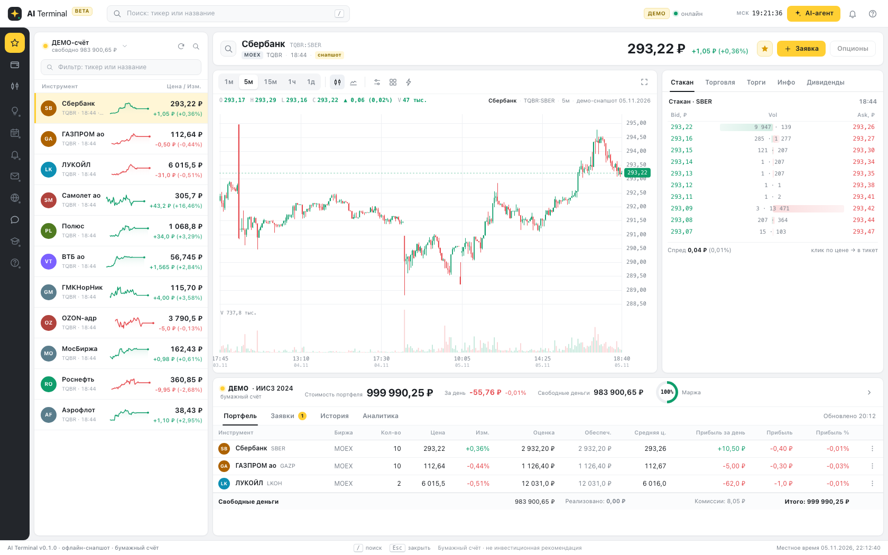

# dsh-trading-transaq — AI-терминал для DeepSeek Harness

DSH-плагин **AI-терминал**: встраивает нативный торговый терминал MOEX/TRANSAQ в Web UI
DeepSeek Harness как **основную панель** — иконка в левой панели, график, стакан, портфель,
заявки, AI-агент и автономные стратегии.



## Состав

| Путь | Что |
|---|---|
| [`dsh-ai-terminal/`](dsh-ai-terminal/README.md) | DSH-плагин: Host-половина (запуск и прокси Go-бэкенда, инструменты, автономный ночной цикл, реле ботов) и Client-половина (main-панель, карточки, локали en/ru/zh) |
| [`docs/migration.md`](docs/migration.md) | как собран репозиторий: происхождение, сохранённая история, решения |
| [`docs/screenshot-*.png`](docs/) | скриншоты панели |

## Где Go-бэкенд

Плагин — только DSH-часть. Терминал и клиент протокола TRANSAQ без DLL живут в
[`kmlebedev/txmlconnector`](https://github.com/kmlebedev/txmlconnector): `cmd/terminal`
(бинарник и встроенная SPA), `terminal/` (REST/SSE, бэктест, rule-боты, paper-счёт),
`native/` (протокол). Плагин запускает бэкенд из checkout'а txmlconnector, который находит
по `repoDir` → env `DSH_AI_TERMINAL_REPO_DIR` → walk-up → соседнему `../txmlconnector`.

## Быстрый старт

Требования: профиль **DSH** с Web UI, Node.js ≥ 24, Go 1.27+ (только для сборки бэкенда).

```bash
git clone https://github.com/kmlebedev/dsh-trading-transaq.git
git clone https://github.com/kmlebedev/txmlconnector.git        # Go-бэкенд
make -C txmlconnector terminal                                  # txmlconnector/bin/terminal

# в DSH-сессии: plugin_manager install_bundle
#   target = <путь>/dsh-trading-transaq/dsh-ai-terminal
```

Если оба checkout'а лежат рядом, плагин найдёт бэкенд сам; иначе добавьте в строку профиля
`config.repoDir` (только абсолютный путь: YAML не раскрывает `~` и переменные окружения) или
env `DSH_AI_TERMINAL_REPO_DIR`.

```yaml
- insert:
    - id: ai-terminal
      name: '@local/dsh-ai-terminal'
      config:
        mode: offline
        port: 18090
        autoStart: true
        # repoDir: /absolute/path/to/txmlconnector   # если checkout не рядом
```

Порядок переключения профиля на новый checkout, smoke и откат — [docs/cutover.md](docs/cutover.md).

Подробности установки, конфигурации и безопасности — [README плагина](dsh-ai-terminal/README.md).
Офлайн-режим работает без сети и ключей на встроенном снапшоте демо-данных; live — read-only
TRANSAQ (`TRANSAQ_*`/`TC_*` в окружении DSH); реальные заявки выключены (paper-only).

## Разработка

```bash
make test      # node --test dsh-ai-terminal/test/ — без Go-бэкенда и сети
make smoke     # proxy-smoke с реальным bin/terminal (нужен checkout txmlconnector)
```

## Лицензия

LICENSE пока не добавлен — решение владельца репозитория (см. [docs/migration.md](docs/migration.md)).
